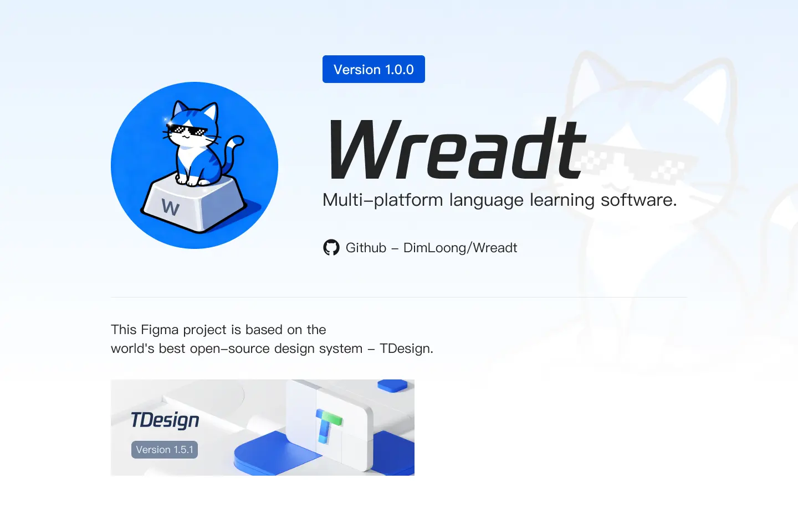

# Wreadt

Multi-platform language learning software.

### Intro

This is not Weird, this is Wreadt, Write + Read. Support Web, iOS, Android, Windows, and MacOS.

Of course we have the [qwerty](https://github.com/RealKai42/qwerty-learner) to learn multiple languages on desktop, but how can we sync our progress on mobile?
Wreadt will solve the problem.

### Background

Wreadt将着重解决这些用户痛点

1. **多端不同步**
   总有人在桌面端学习后，想随时随地在移动端继续进度，但市面大多软件不支持多端，因为开源的项目不提供服务器，商业项目多只支持移动端
2. **支持选取特定行业词，而不是缓慢的全面进步**
   对于某些需求学习语言的人，并不希望以缓慢的方式全面学习词汇，当学习者已经了解了语言基础，他们可能希望快速学习某专业领域常用词+术语，
   再并行学习全面的词汇，Wreadt将支持用户选择某专业领域的词汇术语进行学习
3. **办公友好**
   Wreadt将支持给出多个伪装的页面，包含word/excel/vscode/idea等软件的伪装学习页面，这样你可以大大方方学习了，不用担心谁在窥视你

4. **曲线复习**
   Wreadt将支持艾宾浩斯遗忘曲线渐进式学习

5. **成绩和社交**
   没有人拒绝一个可爱的、成就感可视化的反馈，Wreadt将支持一些拼图可视化地让用户了解他们到底处于什么进度

6. **支持便捷快速的自增词库**
   总有些我们单独记录的短语、词汇逐渐遗忘，现在你可以加入它们到Wreadt以随时复习
   也许可以开放用户授权，去根据用户所记录的词/所选的职业行业，推送用户可能感兴趣的词

7. **支持造句练习**
   通过Ai生成一些近期学习的词汇的题目，例如完形填空，特殊/高频用法示例，错误用法示例，以快速掌握和应用所学词汇

8. **语法训练**
   词汇很重要，但语法也非常重要，在单词例句中加入语法内容、语法提示

### Main technology stack

| 端 | 技术 |
| --- | --- |
| Web（主平台） | React 19 + TypeScript + Vite + TDesign + Sass |
| 共享逻辑 | `packages/core`（TypeScript：类型、词库、打字判定、FSRS 复习调度） |
| 服务端 | Spring Boot（Java）+ PostgreSQL，邮箱密码登录 + JWT，多端同步 |
| iOS / Android | React Native（规划中） |
| Windows / macOS | Tauri（规划中） |

UI Design System: TDesign (RIP to ArcoDesign)

详见 [docs/architecture.md](docs/architecture.md) 与 [ROADMAP.md](ROADMAP.md)。

### Just Noted

1. 在错误拼写多次的时候，应该给出一些字母的提示
2. 对于动画，应考虑Rive
3. 对于日语的片假名，尤其是外来词，应当给出对应的英文单词和翻译

### Getting started

```bash
pnpm install
pnpm dev                 # Web: http://localhost:25173
pnpm test                # 前端与 core 单测

cd apps/server
./mvnw spring-boot:run   # 服务端: http://localhost:8080（开发模式使用内嵌 H2）
./mvnw test
```

### Deploy

前端部署在 Vercel，配置见 `apps/web/vercel.json`（SPA 路由回退到 `index.html`，只有 `apps/web`、`packages/core` 或依赖变化时才重新构建）。在 Vercel 导入仓库时把 Root Directory 设为 `apps/web`（Vercel 会在工作区根目录安装依赖），其余设置由 `vercel.json` 提供。

服务端（`apps/server`，Spring Boot）不能跑在 Vercel 上，需要单独部署。不部署服务端时，前端的打字、词库、复习和自带 Key 的 AI 功能都可以正常使用，只是没有登录同步、服务端 AI 与云端语音。

| 位置 | 变量 | 说明 |
| --- | --- | --- |
| Vercel 环境变量 | `VITE_API_BASE` | 服务端 API 地址，如 `https://api.example.com/api`（构建时写入，修改后需重新部署） |
| Vercel 环境变量（可选） | `VITE_SENTRY_DSN` | 配置后加载 Sentry 上报前端报错（不收集请求头、请求体与个人信息）；不配置时不加载 |
| 服务端环境变量 | `WREADT_CORS_ORIGINS` | 加上 Vercel 的域名，如 `https://wreadt.vercel.app` |

访问统计与性能数据使用 Vercel Web Analytics 与 Speed Insights，需在 Vercel 项目的 Analytics、Speed Insights 页面中启用。每次 push 由 GitHub Actions（`.github/workflows/ci.yml`）跑类型检查、lint、单测、生产构建与词库校验。

### Credits

- 考试 / 行业 / 日语词库来自 [qwerty-learner](https://github.com/RealKai42/qwerty-learner)（GPL-3.0）
- 职业词库（软件开发、产品经理、UI、UX、测试）由 Wreadt 整理，位于 `apps/web/public/dicts/roles/`
- 英文词库中缺失的词性由 [ECDICT](https://github.com/skywind3000/ECDICT)（MIT）匹配补全（`scripts/enrich-pos.mjs`，只在本地处理，不分发 ECDICT 数据）
- 拼完后的音节拆分使用 [Moby Hyphenator II](https://www.gutenberg.org/ebooks/3204)（公有领域）的词典式音节划分，由 `scripts/build-syllables.mjs` 生成 `apps/web/public/syllables.json`；查不到的词退回 [hyphen](https://github.com/ytiurin/hyphen)（ISC）的 TeX 断字规则
- 单词发音来自有道词典公开发音接口（失败时改用本机语音）；整句朗读优先使用阿里云百炼的千问语音合成（服务端配置 `WREADT_TTS_API_KEY`，或用户自带千问 Key），否则使用浏览器 / 系统自带的语音合成

### License

[GPL-3.0](LICENSE)
