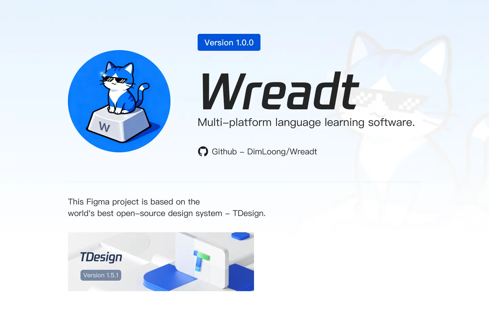

# Wreadt

边打字，边记单词。Write + Read。

[在线使用](https://wreadt.vercel.app)

## 功能

- **默写单词**：逐字母拼写，拼错几次后提示字母。
- **词库**：考试、职业与行业词库，支持英语和日语；也可以建立自己的词库。
- **复习**：按遗忘曲线安排复习。
- **AI 练习**：填空、中译英，以及在句子里用上学过的词。
- **办公模式**：以文档、表格或代码编辑器的样子显示。
- **同步**：登录后，进度在各设备间保持一致。

## 开发

```bash
pnpm install
pnpm dev                 # http://localhost:25173
pnpm test

cd apps/server
./mvnw spring-boot:run   # http://localhost:8080，使用内嵌 H2
```

架构见 [docs/architecture.md](docs/architecture.md)，计划见 [ROADMAP.md](ROADMAP.md)。

## 部署

前端部署在 Vercel，Root Directory 设为 `apps/web`，其余配置见 `apps/web/vercel.json`。

服务端需单独部署。不部署服务端时，除登录同步、服务端 AI 与云端语音外，其他功能均可使用。

| 位置 | 变量 | 说明 |
| --- | --- | --- |
| Vercel | `VITE_API_BASE` | 服务端 API 地址，构建时写入 |
| Vercel（可选） | `VITE_SENTRY_DSN` | 前端错误上报 |
| 服务端 | `WREADT_CORS_ORIGINS` | 允许的前端域名 |

## 致谢

- 考试、行业与日语词库：[qwerty-learner](https://github.com/RealKai42/qwerty-learner)（GPL-3.0）
- 词性补全：[ECDICT](https://github.com/skywind3000/ECDICT)（MIT）
- 音节拆分：[Moby Hyphenator II](https://www.gutenberg.org/ebooks/3204)（公有领域）、[hyphen](https://github.com/ytiurin/hyphen)（ISC）
- 发音：有道词典；整句朗读：阿里云百炼

## 许可

[GPL-3.0](LICENSE)
